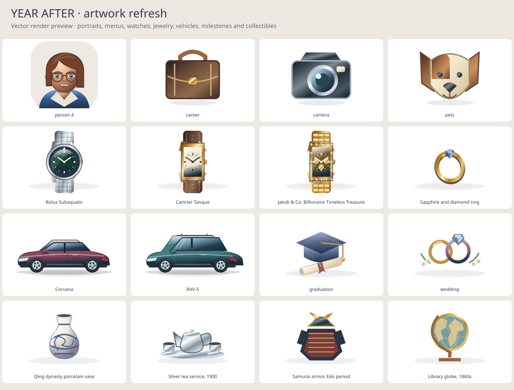

# November — artwork realism continuation

Continues merged PR #37 on `integrate/sports-on-main` (`bc89a90`).
Payton requested more realistic, detailed and distinct artwork throughout the
existing illustrated interface, using the supplied BitLife screenshots as
quality references. The result retains original YEAR AFTER drawings and colors.

## Implementation

- Shared menu stamps now depict colored objects with material shading instead
  of placing a line glyph over a pastel tile. Direction, close and overflow
  controls remain simple navigation glyphs.
- Portraits have shaded skin, brows, irises, noses, lips, hair highlights and
  clothing. Their decorative identity remains deterministic from the existing
  ID; an improved hash mix distributes hairstyles across consecutive IDs.
- All 55 watch profiles retain their individual case, dial, band and face
  treatments. The render adds metallic cases, bracelet structure, lugs,
  crown details, minute markers, subdial detail, reflections and faceted stones.
  Iced stones follow the shape of the bezel rather than covering rectangular
  dials with a circular ring.
- The 42 jewelry designs use shaded bands, faceted stones, pearl surfaces,
  clasps and connected chains. Shops, collections and auction dialogs continue
  sharing the same renderer.
- Vehicle artwork adds shaded bodywork, glass, door seams, mirrors, lighting,
  wheel spokes and trim-dependent paint. All 247 trims across 104 models use
  the renderer. Cars still share body-style silhouettes; this is not a bespoke
  manufacturer-accurate drawing for each model.
- The other 72 valuables now have subject-based drawings for framed works,
  furniture, clocks, ceramics, historical objects, curios and mythical objects,
  replacing the previous generic vase/document treatments. Some related pieces
  still share geometry; these remain stylized illustrations, not replicas.
- All 14 milestone scenes receive material shading and additional object details.
  Storage units show a closed shutter, structural depth, lock and threshold.

Changes are limited to mobile artwork, the SVG test host and documentation.
Engine behavior, saves, RNG streams, prices, item data and auction disclosures
are unchanged. Portrait appearance changes are decorative and not persisted.

## Verification

- `pnpm verify`: 15 package typechecks, 5,586 tests and content validation pass.
  The mobile suite contains 853 tests, including two new artwork regressions.
- Catalog render test mounts all 169 valuables, iced watch variants and all 247
  vehicle trims together. It checks unique gradient IDs, valid paint references
  and finite geometry. Repeated item instances cannot borrow another's colors.
- Auction test checks that changing hidden value, room bid ceiling or authenticity
  does not change the artwork.
- Mutation checks deliberately reuse gradient IDs and derive storage geometry
  from hidden value. Both are caught; files are restored byte-for-byte and the
  focused tests pass again.
- Changed source files pass Prettier and `git diff --check`.
- 257 vector render cases were reviewed, including the entire valuable catalog,
  menu objects, portraits, milestones, all nine body styles and iced examples.
  These are rendered from the actual component geometry using temporary host
  adapters, not screenshots of a running native application.

## Remaining check

Actual iOS/Android device inspection remains open. The native SVG boundary is
mocked in component tests. Rendering previews verify composition and materials,
but do not establish native frame time or screen layout on a physical phone.
The project owner remains the authority on whether this degree of stylization
meets the requested visual direction.
